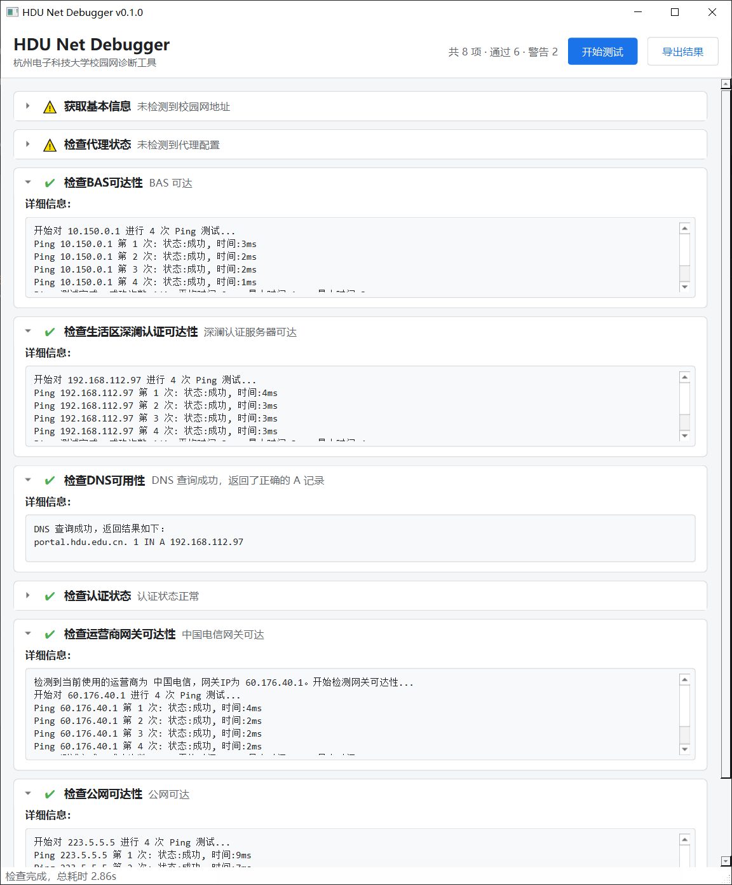

# HDU NetDebugger (Uwu)

> 杭州电子科技大学校园网诊断工具 —— [HDU-ICU/HDU_NetDebugger](https://github.com/HDU-ICU/HDU_NetDebugger) 的 Python 复刻版。
> **CLI 优先**，另提供 PySide6 可选 GUI。

一键跑完 11 项网络体检，逐项给出 **状态 / 总览 / 警告 / 建议 / 详细日志**，并可导出 Markdown
或 JSON 报告，方便直接贴给 ICU（网络中心）排查。

```text
$ hnd
╭──────────────────────── HDU Net Debugger ────────────────────────╮
│ 检查时间 2025-01-01 12:00:00     共 11 项 · 通过 7 · 警告 3 · 失败 1 │
╰──────────────────────────────────────────────────────────────────╯
 ✔ 获取基本信息              检测到生活区网络
 ✔ 检查代理状态              未检测到代理配置
 ✔ 检查BAS可达性             BAS 可达
 ✔ 检查生活区深澜认证可达性    深澜认证服务器可达
 ✔ 检查DNS可用性             DNS 查询成功，返回了正确的 A 记录
 ✔ 检查认证状态              认证状态正常
 ✔ 检查运营商网关可达性        中国电信网关可达
 ✖ 检查公网可达性             公网不可达
 …
```

## 检查项

| # | 检查项 | 一句话 |
|---|--------|--------|
| -1 | 获取基本信息 | 枚举网卡、识别生活区 / 教学区 / eduroam 网段、解释异常网段、嗅探 VPN / Tunnel |
| 5 | 检查代理状态 | 系统代理与 `HTTP_PROXY` / `HTTPS_PROXY` 等环境变量代理 |
| 10 | 检查 BAS 可达性 | Ping 生活区 BAS，不可达时判断是否根本不在校园网 |
| 15 | 检查生活区深澜认证可达性 | Ping 深澜认证服务器 |
| 20 | 检查 DNS 可用性 | 校验校园 DNS 的解析结果，并用系统解析器对照、检测本机 DNS 接管 |
| 25 | 检查认证状态 | 读深澜 `rad_user_info`：在线设备、运营商、错误码、会话与配额 |
| 30 | 检查运营商网关可达性 | 按运营商逐个探测候选出口网关 |
| 35 | 检查公网可达性 | 双锚点 Ping + HTTP 探针，识别门户劫持 |
| 37 | 检查路径 MTU | DF 二分探测，识别"小包通、大包不通"（**新增**） |
| 38 | 检查 IPv6 | 有没有可用的 v6 地址、能否出网、v6 路径 MTU（**新增**） |
| 39 | 检查逐跳路径 | 指出断点在第几跳；有 TUN 时直接放弃（**新增**） |

原版 8 项的执行次序原样保留，新增的 3 项排在后面。每项的判据、实测证据、以及与 ICU
官方手册的核对结果见 **[docs/checks.md](docs/checks.md)**。

## 快速开始

需要 Python ≥ 3.12 与 [uv](https://docs.astral.sh/uv/)。

```bash
git clone <repo> && cd Hdu_netDebugger_Uwu
uv sync --no-default-groups      # 只要 CLI；用 GUI 换成 uv sync --extra gui

uv run hnd                       # 跑完整套检查（等价于原版「开始测试」）
uv run hnd run --json            # 机器可读输出
uv run hnd run -o report.md      # 导出 Markdown 报告
uv run hnd run -v                # 打印每一项的详细日志与证据
uv run hnd list                  # 列出所有检查项
uv run hnd doctor                # 自检：运行环境、依赖、Ping 后端
uv run hnd gui                   # 启动图形界面
```

`hdu-netdebugger` 是 `hnd` 的等价长命令。

常用参数：

| 参数 | 说明 |
|------|------|
| `--only` / `--skip` | 按名称（支持前缀 / 模糊匹配）筛选检查项，可重复 |
| `-f, --format {text,json,md}` | 输出格式，默认 `text` |
| `-o, --output PATH` | 写入文件；`-` 表示 stdout |
| `-v, --verbose` | 输出每一项的详细日志 |
| `--timeout SEC` / `--ping-count N` | 单次 Ping 超时（默认 `1.0`）/ 次数（默认 `4`） |
| `--ping-backend NAME` | `auto` / `icmplib` / `windows-icmp` / `system` |
| `--dns-server IP` | 覆盖查询用的 DNS 服务器 |
| `--campus-network CIDR` | 把该网段也当作校园网（可重复）；校园网拓扑会变，确认过的新网段用它加上即可 |
| `--insecure` / `--no-env-proxy` | 跳过 TLS 校验 / 忽略环境变量代理 |

退出码：`0` 全部通过 · `1` 存在警告 · `2` 存在失败 · `3` 工具自身错误（含参数写错等用法错误）。
可直接用于 CI / 脚本：结果码与"调用错误"不撞码。

> 直接敲 `hnd`（一个参数都不给）时，检查结束会**停一下等按键**再退出 —— 双击 exe 的同学
> 不会看到黑窗口一闪而过。带了任何参数、或 stdin 不是终端时都不会停；等待上限 120 秒。

## GUI

```bash
uv run hnd gui
```



> 截图取自一次真实运行（v0.1.0，生活区网段 + 电信出口）：警告来自代理的隧道网卡与
> "在路由器后使用"这两个**按设计给出**的提示，不是故障。

复刻原版交互：顶部「开始测试 / 导出结果」，下面是一列可展开的检查卡片，图标按状态着色
（跳过用橙色，与"未检查"的灰区分开，与原版一致），失败与警告项自动展开。检查跑在独立
`QThread` 里，关窗走协作式异步关闭，不会卡界面也不会硬杀线程。

## 打包成可执行文件

```bash
make exe                                 # 或 uv run --group build pyinstaller --clean --noconfirm packaging/hnd.spec
uv run python scripts/dist_smoke.py      # 打完必须跑一遍产物自检
```

| 产物 | 形态 | 说明 |
|------|------|------|
| `dist/hnd.exe`（Linux/macOS 下是 `dist/hnd`） | onefile | CLI，单文件 14 MB，排除了 PySide6 |
| `dist/HDU-NetDebugger/` | onedir | GUI，带 Qt，约 121 MB |
| `dist/hnd-gui-smoke/` | onedir | 只给 CI 用：证明打进包里的 Qt 能用 |

选型取舍（为什么 PyInstaller 而不是 Nuitka、为什么不用 UPX、typer → click 的实测结论、
冻结后编码与 OpenSSL 的坑）见 **[docs/packaging.md](docs/packaging.md)**。

## 文档

| 文档 | 内容 |
|------|------|
| [docs/checks.md](docs/checks.md) | 检查项详解、比原版多做的诊断、与 ICU 官方手册的核对 |
| [docs/packaging.md](docs/packaging.md) | 打包选型与取舍、体积实测、跨平台构建 |
| [docs/development.md](docs/development.md) | 开发命令、测试与 CI、项目结构、跨平台说明、真机验证 |
| [docs/roadmap.md](docs/roadmap.md) | 后续计划、待确认的时效性事实、已知机制疑点 |
| [docs/parity.md](docs/parity.md) | 与 C# 原版的实现差异、复刻中修正的问题 |

## 质量

`ruff`（`select = ["ALL"]` + 逐条说明理由的 ignore）+ `ty` 类型检查 + pytest（**677 个用例**，
覆盖率门槛 80%，当前 ~93%）+ GitHub Actions（lint / test / build wheel / 冻结产物自检）。
检查项测试全部注入假网络（`tests/fakes.py`），毫秒级跑完、不产生真实流量。

## License

MIT
