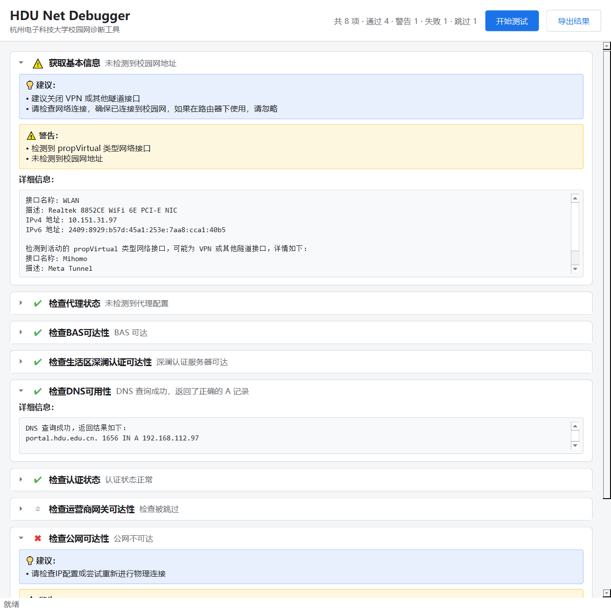

# HDU NetDebugger (Uwu)

> 杭州电子科技大学校园网诊断工具 —— [HDU-ICU/HDU_NetDebugger](https://github.com/HDU-ICU/HDU_NetDebugger) 的 Python 复刻版。
> **CLI 优先**，另提供 PySide6 可选 GUI。

一键跑完 8 项网络体检，逐项给出 **状态 / 总览 / 警告 / 建议 / 详细日志**，并可导出 Markdown 或 JSON 报告，
方便直接贴给 ICU（网络中心）排查。

```text
$ hnd
╭──────────────────────── HDU Net Debugger ────────────────────────╮
│ 检查时间 2025-01-01 12:00:00            共 8 项 · 通过 6 · 警告 1 · 失败 1 │
╰──────────────────────────────────────────────────────────────────╯
 ✔ 获取基本信息              检测到生活区网络
 ✔ 检查代理状态              未检测到代理配置
 ✔ 检查BAS可达性             BAS 可达
 ✔ 检查生活区深澜认证可达性    深澜认证服务器可达
 ✔ 检查DNS可用性             DNS 查询成功，返回了正确的 A 记录
 ✔ 检查认证状态              认证状态正常
 ✔ 检查运营商网关可达性        中国电信网关可达
 ✖ 检查公网可达性             公网不可达
```

## 功能

复刻自 C#/Avalonia 原版的全部检查项，按 `order` 顺序执行：

| # | 检查项 | 说明 |
|---|--------|------|
| -1 | 获取基本信息 | 枚举活动网卡，识别**生活区**（`10.150.0.0/16`）/ **教学区**（`10.249.0.0/16`）网段，并嗅探 VPN / Tunnel 网卡 |
| 5 | 检查代理状态 | 检测系统代理与 `HTTP_PROXY` / `HTTPS_PROXY` 等环境变量代理 |
| 10 | 检查 BAS 可达性 | Ping `10.150.0.1`，不可达时进一步判断是否根本不在校园网 |
| 15 | 检查生活区深澜认证可达性 | Ping 深澜认证服务器 `192.168.112.97` |
| 20 | 检查 DNS 可用性 | 向 `210.32.32.1` 查询 `portal.hdu.edu.cn` 的 A 记录并校验返回值 |
| 25 | 检查认证状态 | 请求深澜 `rad_user_info`，解析在线设备、运营商、错误码 |
| 30 | 检查运营商网关可达性 | 依据上一步解析出的运营商 ID Ping 对应出口网关（联通 / 电信 / 移动） |
| 35 | 检查公网可达性 | Ping 阿里 DNS `223.5.5.5` + HTTP 探测 `generate_204` |

检查之间存在**依赖**：例如 DNS 不可用时会自动改用 IP 直连请求认证接口，运营商 ID 无效时
"运营商网关可达性"会被标记为 `跳过` 而不是失败。

## 安装

需要 Python ≥ 3.12 与 [uv](https://docs.astral.sh/uv/)。

```bash
git clone <repo> && cd Hdu_netDebugger_Uwu

# 仅 CLI
uv sync

# 带 GUI
uv sync --extra gui

# 开发（含 lint / test 工具链）
uv sync --all-groups --extra gui
```

## 使用

### CLI

```bash
uv run hnd                      # 跑完整套检查（等价于原版「开始测试」）
uv run hnd run                  # 同上，显式子命令
uv run hnd run --json           # 机器可读输出（适合脚本 / CI）
uv run hnd run -o report.md     # 导出 Markdown 报告
uv run hnd run -v               # 打印每一项的详细日志
uv run hnd run --only 检查DNS可用性 --only 检查认证状态
uv run hnd run --skip 检查公网可达性
uv run hnd list                 # 列出所有已注册的检查项
uv run hnd doctor               # 自检：运行环境、依赖、权限
uv run hnd gui                  # 启动 PySide6 图形界面
```

`hdu-netdebugger` 是 `hnd` 的等价长命令。

常用参数：

| 参数 | 说明 |
|------|------|
| `--only` / `--skip` | 按名称（支持前缀/模糊匹配）筛选检查项，可重复 |
| `-f, --format {text,json,md}` | 输出格式，默认 `text` |
| `-o, --output PATH` | 写入文件；`-` 表示 stdout |
| `-v, --verbose` | 输出每一项的详细日志 |
| `--timeout SEC` | 单次 Ping 超时（默认 `1.0`） |
| `--ping-count N` | 每个目标 Ping 次数（默认 `4`） |
| `--insecure` | 跳过 TLS 证书校验（校园网自签证书场景） |
| `--no-env-proxy` | 忽略 `HTTP_PROXY` / `HTTPS_PROXY` 环境变量直连 |
| `--dns-server IP` | 覆盖查询用的 DNS 服务器 |

退出码：`0` 全部通过 · `1` 存在警告 · `2` 存在失败 · `3` 工具自身错误。可直接用于 CI / 脚本。

### GUI

```bash
uv run hnd gui
# 或
uv run python -m hdu_netdebugger.gui
```



图形界面复刻原版交互：顶部「开始测试 / 导出结果」，下面是一列可展开的检查卡片，
图标按状态着色（灰=未检查、蓝=进行中、绿=通过、黄=警告、红=失败、灰=跳过），
失败与警告项会自动展开。检查在独立 `QThread` 里运行，界面不会卡死；
关闭窗口会协作式取消未开始的检查并等待线程退出。

无显示环境（CI / 远程）下可以用离屏渲染验证界面：

```bash
uv run python scripts/gui_render_sample.py out.png      # 用固定样本渲染
uv run python scripts/gui_smoke.py out.png              # 真跑一轮检查再截图
```

## 项目结构

```text
src/hdu_netdebugger/
├── cli.py            # Typer CLI 入口
├── constants.py      # 杭电网络常量（网段 / 服务器 IP / 深澜错误码 / 运营商映射）
├── context.py        # 检查间共享状态（取代原版 GlobalFlagList）
├── registry.py       # @checker / @condition 装饰器与检查项注册表
├── runner.py         # 编排：条件判定 → 执行 → 汇总裁剪
├── report.py         # Markdown / JSON 报告生成
├── models/           # 数据模型（检查结果、深澜响应、Ping 结果）
├── net/              # 网络能力（异步 Ping、HTTP、DNS）
├── checkers/         # 8 个检查项实现
└── gui/              # PySide6 可选图形界面
```

## 开发

```bash
make dev      # uv sync --all-groups --extra gui
make lint     # ruff format --check + ruff check + ty check
make fmt      # ruff check --fix + ruff format
make test     # pytest（含覆盖率门槛 80%）
make build    # uv build
```

质量工具链：

- **[uv](https://docs.astral.sh/uv/)** — 依赖与虚拟环境管理
- **[ruff](https://docs.astral.sh/ruff/)** — lint + format（替代 flake8 / black / isort）
- **[ty](https://docs.astral.sh/ty/)** — 类型检查（替代 mypy / pyright）
- **pytest + pytest-asyncio + coverage** — 测试

## 与 C# 原版的差异

| 原版 | 本复刻 |
|------|--------|
| C# 特性 + 反射扫描注册检查项 | Python 装饰器 `@checker(...)` 注册，显式可读 |
| `ConcurrentDictionary<string, object> GlobalFlagList` | 强类型 `CheckContext` 数据类 |
| `System.Net.NetworkInformation.Ping` | `icmplib` 原始套接字，**失败时回退系统 `ping` 命令**（免管理员权限） |
| `DnsClient` | `dnspython` 异步解析器，可指定 DNS 服务器 |
| `HttpClient` | `httpx.AsyncClient`（默认不跟随重定向、不保留 Cookie） |
| MVVM + Avalonia | Typer CLI（主）+ PySide6 可选 GUI |
| 无测试 | pytest 测试套件 + GitHub Actions CI |

## License

MIT
